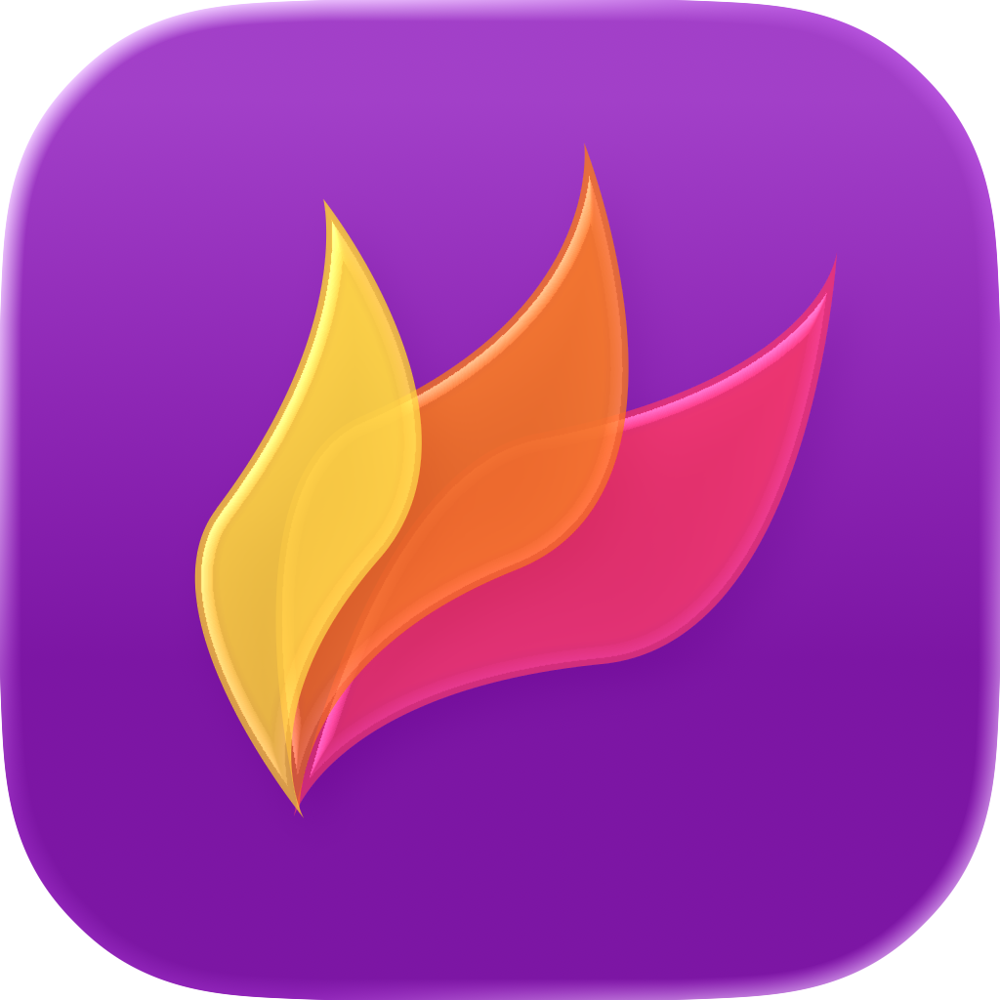

<p align="center"></p>

# Flameshoter

A macOS screenshot and annotation app derived from [Flameshot](https://github.com/flameshot-org/flameshot). Starting with **0.2.0 the application is entirely Swift / AppKit**, with no Qt or third-party runtime dependencies. English and Simplified Chinese are supported.

[简体中文](README.md) · [Releases](https://github.com/Word2VecT/flameshoter/releases)

## Install

Requires Apple Silicon and macOS 26 or newer.

```sh
brew install --cask Word2VecT/tap/flameshoter
brew upgrade --cask flameshoter
```

Allow Screen Recording when first capturing. Releases retain the fixed self-signed certificate and bundle identifier introduced in 0.1.2. This preserves the application identity across updates. Migrating from earlier ad hoc signatures requires granting access once again.

The app is not Apple notarized. Gatekeeper may require the system's Open Anyway action on first launch. The tap does not remove quarantine or disable system protections. Use Settings → Capture → Repair authorization only when an existing permission entry is broken; it resets this app's entry.

## Features

- Region capture, all-display capture, display selection, delay and command-line output.
- Pencil, line, arrows, rectangles, ellipses, marker, redaction, text, numbered annotations and inversion.
- Native tool inspector, colors, text formatting, annotation layers and UndoManager.
- Save, copy, open with another application and floating pinned captures.
- Seven settings pages, global shortcut recording and legacy INI import.
- The Dock icon hides after the last ordinary window closes; the menu-bar item remains. Minimized windows retain the Dock icon.

The default global capture shortcut is **⌘⇧X**. Press Space or right-click for tool settings. Use ⌘C to copy, ⌘S to save, ⌘Z / ⌘⇧Z for undo / redo and Esc to cancel.

```sh
flameshoter gui -d 2000
flameshoter full -p ~/Pictures
flameshoter screen -n 0 --raw > capture.png
flameshoter gui --region 640x360+120+80 --accept-on-select -p ~/Pictures
flameshoter config
```

`full` combines all displays. Run `--help` for details. Native settings are stored at `~/Library/Application Support/Flameshoter/settings.json`; existing Flameshoter INI settings are migrated on first launch without deleting the original.

## Apple-native UI

The selection uses NSGlassEffectView Clear, with the sharp capture as foreground content and the system glass visible around its rim. The outside uses NSVisualEffectView FullScreenUI frost. Controls use AppKit, including glass groups, menus, preferences, color and file panels, text editing and pinned windows. ScreenCaptureKit captures the desktop; Swift and Core Graphics implement annotation content. No custom glass shader or blur imitation is used, and the preview material never alters exported pixels.

The layered icon is authored with Apple Icon Composer and compiled by actool. The source is [Flameshoter.icon](packaging/macos/Flameshoter.icon).

[Building](docs/BUILDING.md) · [Design](docs/DESIGN.md) · [Release notes](docs/RELEASE_NOTES.md)

GPL-3.0-or-later. Initially based on Flameshot commit `da34dcb1b296bd2e3bc589767abbe788084215ae`. Original authors and contributors retain attribution. The earlier Qt implementation remains in Git history; current sources target macOS only. See [LICENSE](LICENSE) and [provenance](THIRD_PARTY.md).
