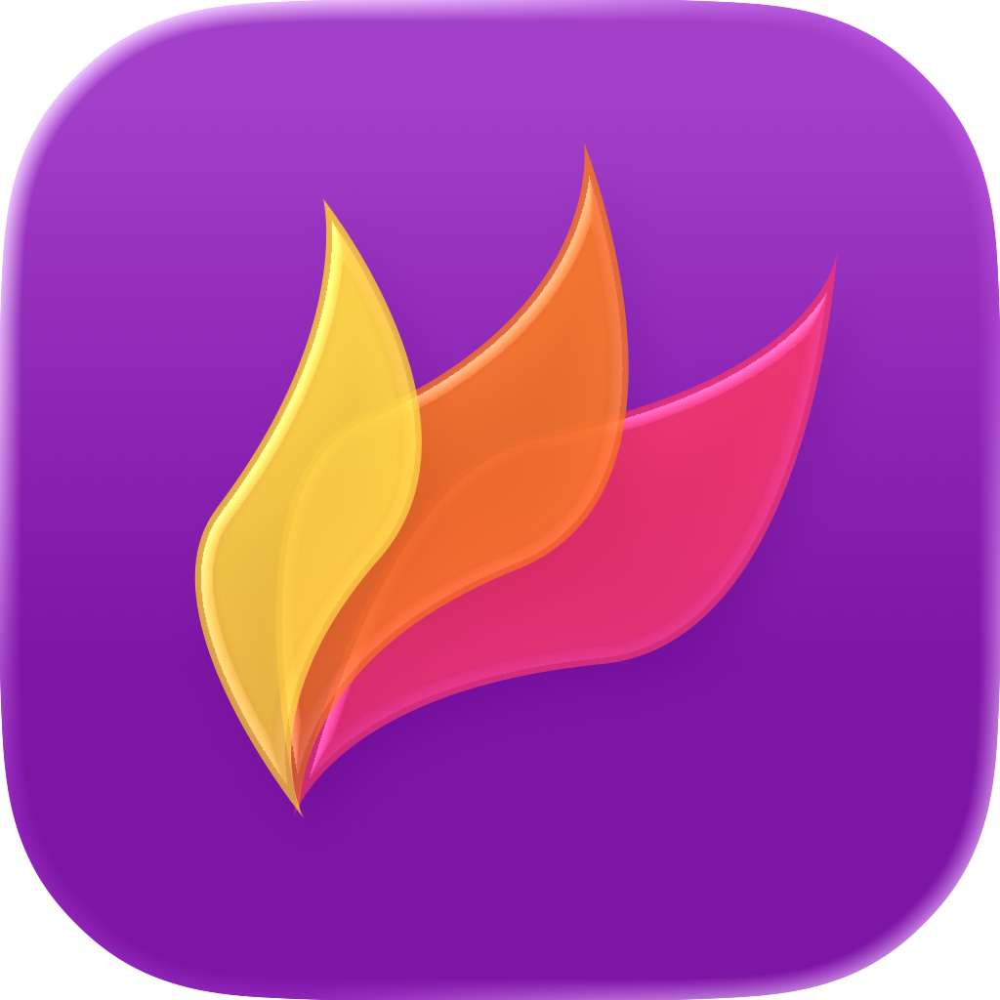
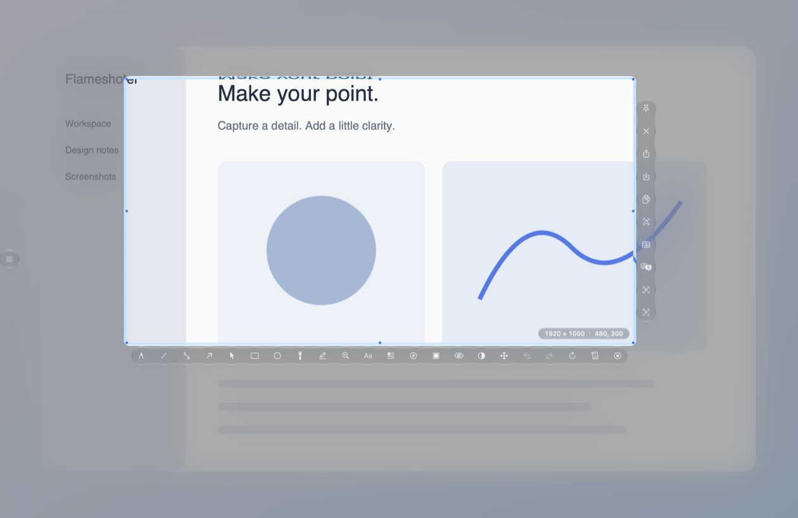

<div align="center">
  
  <h1>Flameshoter</h1>
  <p>A native screenshot tool for the Mac menu bar. Annotate a selection, extract text, pin a reference, or record a walkthrough.</p>
  <p>
    <a href="https://github.com/Word2VecT/flameshoter/actions/workflows/macos.yml"></a>
    <a href="https://github.com/Word2VecT/flameshoter/releases"></a>
    <a href="LICENSE"></a>
  </p>
  <p><a href="#installation">Install</a> · <a href="#your-first-capture">Your first capture</a> · <a href="#keyboard-shortcuts">Shortcuts</a> · <a href="https://github.com/Word2VecT/flameshoter/issues">Report an issue</a> · <a href="README.md">简体中文</a></p>
</div>

<p align="center">
  <picture>
    <source media="(prefers-color-scheme: dark)" srcset="docs/images/region-capture-dark.png">
    
  </picture>
</p>

## Installation

Requires an **Apple Silicon Mac running macOS 26 or later**. Install the app and command-line tool with Homebrew.

```sh
brew install --cask Word2VecT/tap/flameshoter
```

To update, run `brew upgrade --cask flameshoter`. You can also download the arm64 ZIP, unzip it, and move `Flameshoter.app` to Applications. If macOS blocks the first launch, choose **Open Anyway** in System Settings → Privacy & Security. [Downloads and release notes](https://github.com/Word2VecT/flameshoter/releases/latest)

Version 0.3.11 adds offline text extraction with PP-OCRv6 Small for screenshots and pins. [Build guide](docs/BUILDING.md)

## Your first capture

1. Open Flameshoter and press the default shortcut **⌘⇧X**, or choose **Capture region** from the flame icon in the menu bar.
2. Grant Flameshoter Screen Recording access when macOS prompts you. If macOS asks you to restart the app, reopen it and start the capture again.
3. Drag to select an area. Press **A** to draw an arrow or **T** to add text. Press **⌘C** to copy, **⌘S** to save, or **⌘P** to pin the image above other windows.

## What you can do

| Task | How it works |
| --- | --- |
| Capture a page or conversation | Capture a region, window, or chosen display, or set a delay. For a long page, press **L** to scroll vertically or horizontally, then preview and crop. Hold **F5** to see the live screen and release to refresh the selection with your annotations intact. |
| Mark a detail or redact a screenshot | Use arrows, polylines, numbered steps, spotlights, magnifiers, and watermarks in the Liquid Glass toolbar. Press **⇧B** to find email addresses, phone numbers, URLs, IP addresses, labeled credentials, and faces on your Mac. Review, adjust, or undo each redaction. |
| Keep a reference in view | Pin a capture or clipboard content, including images, animated GIF or WebP, text, colors, and files. Rotate, flip, or annotate a static pin. Restore closed pins even after restarting the app. |
| Work with text and tables | Select text, read QR codes and barcodes, or create a translated image from a capture or pin. Edit and sort table cells before exporting to CSV or Excel. Export document text as editable paragraphs in Word, RTF, TXT, or Markdown. |
| Record a walkthrough | Press **G** in a selection. Add system or microphone audio, pause, trim, or show clicks, keyboard shortcuts, and a camera overlay. In the preview, choose MP4 to keep recorded audio, or GIF, APNG (`.png`), or WebP for a silent animation. |
| Export and share | Compare the original and encoded preview, check dimensions and file size, and adjust JPEG or AVIF quality. Export PDF, lossless WebP, or an optionally optimized PNG, or use the system share sheet. Press **⌥C** to copy the color under the pointer. |

**Local processing and history.** Recognize Text on screenshots and pins uses the bundled PP-OCRv6 Small model to extract and copy text offline. You can also select text in the original image with Live Text. Redaction, table recognition, and document recognition run on your Mac. Translation may need an initial language-pack download. Editable screenshot history stores the **original selection before redaction**. For sensitive captures, set **Screenshots retained** to 0 in Settings and use **Clear screenshot history** to remove existing records.

**Optional permissions.** Interface-element detection and automatic scrolling use Accessibility access. Camera and keyboard overlays are off by default. Enabling them requests Camera or Input Monitoring access. Keyboard overlays show shortcuts and navigation keys and skip ordinary typing and secure input.

## Keyboard shortcuts

Use Settings in the menu bar to change capture shortcuts, language, and tools. These are the defaults.

| Where | Keys | Action |
| --- | --- | --- |
| Global | ⌘⇧X | Start a region capture |
| Global | ⌃⇧2 / ⌃⇧3 | Pin clipboard / restore last closed pin |
| Capture | ⌘C / ⌘S / ⌘⇧S / ⌘P | Copy / save / share / pin |
| Capture | ⇧C / Q / ⌥Q / ⇧Q / ⌥D | Read text / scan codes / translate / recognize table / recognize document |
| Capture | L / G / Esc | Scrolling capture / record screen / cancel |
| Image pin | L / Space | Toggle lock / annotate again |

<details>
<summary>Annotation, color, and history shortcuts</summary>

| Keys | Action |
| --- | --- |
| P / D / A | Pencil / line / arrow |
| R / C / M | Rectangle / ellipse / highlighter |
| T / N / B / ⇧B | Text / number / redact / automatic redaction |
| V / O / E / W | Polyline / spotlight / magnify / watermark |
| ⌘Z / ⌘⇧Z | Undo / redo |
| Space / right-click | Open Tool Settings |
| ⌥C | Copy the color under the pointer. Hold ⌥ and press ⇧ to cycle formats. |
| [ / ] | Previous / next capture region |
| , / . | Previous / next editable capture on the same display and scale |
| F5 | Hold to see the live screen and release to refresh |

Click to place polyline vertices, then double-click or press Return to finish. Backspace removes a vertex and Esc discards the current polyline. Use a pin's context menu to rotate, flip, or annotate it. Press Return after annotating to create a new pin.

</details>

## Command line

Homebrew installs the `flameshoter` command. If you installed the ZIP, you can run `/Applications/Flameshoter.app/Contents/MacOS/Flameshoter` directly.

```sh
flameshoter gui                    # Select a region interactively
flameshoter gui -d 2000            # Start the selection after two seconds
flameshoter full -p ~/Pictures     # Save the entire desktop to Pictures
flameshoter screen -n 0 --raw > display.png
flameshoter config                 # Open Settings
```

Run `flameshoter --help` for all options.

## Development and contributions

Build and package the app with Xcode 27 or later. The build guide covers tests and icon assets for developers using Command Line Tools alone. [Build guide](docs/BUILDING.md) · [Contribution guide](docs/CONTRIBUTING.md)

```sh
git clone https://github.com/Word2VecT/flameshoter.git
cd flameshoter
./scripts/build-macos.sh --package
```

For feature comparisons, see the [Snow Shot comparison](docs/SNOW_SHOT_COMPARISON.md) and [PixPin comparison](docs/PIXPIN_PARITY.md) (both in Chinese).

Thanks to the authors and contributors of Flameshot. Flameshoter uses GPL-3.0-or-later. Its icon derives from Flameshot's artwork under the Free Art License 1.3. [Flameshot](https://github.com/flameshot-org/flameshot) · [Code license](LICENSE) · [Icon license](licenses/FlameshotLogo-FAL-1.3.txt) · [Third-party notices](THIRD_PARTY.md)
