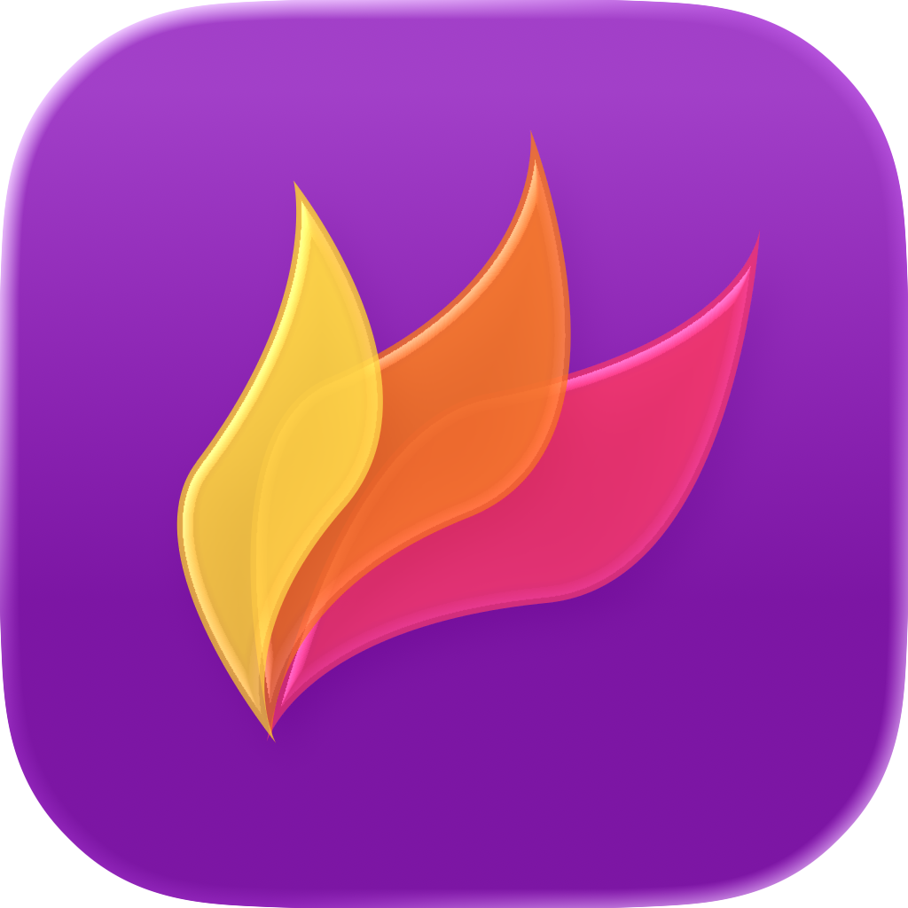

<div align="center">
  
  <h1>Flameshoter</h1>
  <p>Simple screenshot capture and annotation for macOS.</p>
  <p>
    <a href="https://github.com/Word2VecT/flameshoter/actions/workflows/macos.yml"></a>
    <a href="https://github.com/Word2VecT/flameshoter/releases"></a>
    <a href="LICENSE"></a>
  </p>
  <p><a href="README.md">简体中文</a></p>
</div>

## Index

- [Features](#features)
- [Usage](#usage)
- [Keyboard shortcuts](#keyboard-shortcuts)
- [Installation](#installation)
- [Compilation](#compilation)
- [License](#license)
- [Contribute](#contribute)

## Features

- Region capture, multiple displays, delayed captures and automatic window selection; Accessibility access enables interface-element detection.
- Refresh the screen while preserving the selection and annotations; optionally include the pointer in screenshots.
- Save and cycle through capture regions per display.
- Restore screenshot history on the same display and scale, and edit its annotations. History retains the original selected image, including before redaction; recording can be disabled and history cleared in Settings.
- Vertical and horizontal scrolling captures with preview, cropping, copying, saving and pinning.
- Record a region with frame rate, delay, audio, pause, preview and trimming; save as MP4, GIF or animated WebP.
- In-app annotation: pencil, lines, arrows, shapes, text, numbers and redaction.
- Copy, save, pin and share through the macOS share sheet.
- Pin clipboard images, GIF and animated WebP, text, colors and files; restore open and recently closed pins after restarting.
- Recognize text and QR codes offline in captures and pinned images; select text directly in images.
- Translate screenshots or pinned images on your Mac, edit the original and translated text, and create a translated image. Some languages require an initial system download.
- Pick and copy colors in HEX, RGB, HSV and other formats; save as PNG, lossless WebP, PDF, AVIF and more. PNG optimization is optional.
- English, Simplified Chinese and customizable shortcuts.
- Native Apple Liquid Glass interface.

## Usage

Launching Flameshoter keeps it running in the menu bar. Click the flame icon or press **⌘⇧X** to capture, then select a region and annotate it.

You can also use the command line:

```sh
flameshoter gui                    # Region capture
flameshoter gui -d 2000            # Capture after 2 seconds
flameshoter full -p ~/Pictures     # Save a full-screen capture
flameshoter config                 # Open settings
```

Open Settings from the menu bar to change the language, tools and shortcuts. Run `flameshoter --help` for all command-line options.

## Keyboard shortcuts

These are the defaults. Shortcuts can be changed in Settings.

| Keys | Action |
| --- | --- |
| ⌘⇧X | Global region capture |
| P / D / A | Pencil / line / arrow |
| R / C / M | Rectangle / ellipse / highlighter |
| T / N / B | Text / number / redaction |
| ⌘C / ⌘S / ⌘⇧S | Copy / save / share |
| ⌘Z / ⌘⇧Z | Undo / redo |
| ⌘P | Pin capture |
| ⌃⇧2 / ⌃⇧3 | Pin clipboard / restore the last closed pin |
| ⇧C / Q | Recognize text / QR code |
| ⌥Q | Translate a screenshot or pinned image |
| L | Scrolling capture |
| G | Record screen |
| F5 | Hold to view the screen and release to refresh the capture |
| , / . | Previous / next screenshot in history |
| [ / ] | Previous / next capture region |
| ⌥C | Copy the color under the pointer; hold ⌥ and press ⇧ to change formats |
| Space / right-click | Tool settings |
| Esc | Cancel capture |

## Installation

Requires **Apple Silicon and macOS 26 or newer**.

### Homebrew

```sh
brew install --cask Word2VecT/tap/flameshoter
brew upgrade --cask flameshoter
```

### Direct download

Download from [Releases](https://github.com/Word2VecT/flameshoter/releases) and move the app to Applications.

Grant Screen Recording access when first capturing. If macOS blocks the first launch, allow it in System Settings → Privacy & Security.

## Compilation

Use Xcode 27 or newer:

```sh
git clone https://github.com/Word2VecT/flameshoter.git
cd flameshoter
./scripts/build-macos.sh --package
```

See [Building](docs/BUILDING.md) for testing, development and packaging details.

## License

- Code is licensed under [GPL-3.0-or-later](LICENSE).
- The icon derives from Flameshot's artwork and is licensed under the [Free Art License 1.3](licenses/FlameshotLogo-FAL-1.3.txt).
- See [third-party notices](THIRD_PARTY.md) for provenance and license details.

## Contribute

Report bugs or suggest improvements through [Issues](https://github.com/Word2VecT/flameshoter/issues). Pull requests are welcome.

Thanks to the original authors and contributors of [Flameshot](https://github.com/flameshot-org/flameshot).
