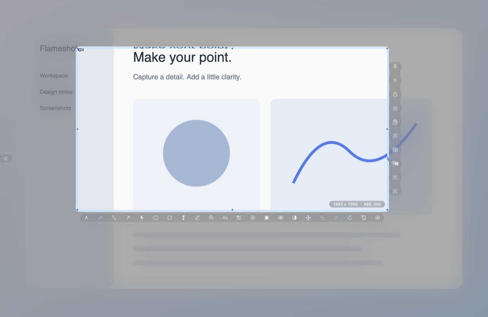

<div align="center">
  
  <h1>Flameshoter</h1>
  <p>Mac 菜单栏里的原生截图工具。在选区旁标注、提取文字、置顶参考图，或录下一段操作。</p>
  <p>
    <a href="https://github.com/Word2VecT/flameshoter/actions/workflows/macos.yml"></a>
    <a href="https://github.com/Word2VecT/flameshoter/releases"></a>
    <a href="LICENSE"></a>
  </p>
  <p><a href="#安装">安装</a> · <a href="#第一次截图">第一次截图</a> · <a href="#快捷键">快捷键</a> · <a href="https://github.com/Word2VecT/flameshoter/issues">反馈问题</a> · <a href="README.en.md">English</a></p>
</div>

<p align="center">
  <picture>
    <source media="(prefers-color-scheme: dark)" srcset="docs/images/region-capture-dark.png">
    
  </picture>
</p>

## 安装

需要 **Apple Silicon Mac 和 macOS 26 或更新版本**。使用 Homebrew 安装应用和命令行工具：

```sh
brew install --cask Word2VecT/tap/flameshoter
```

更新时运行 `brew upgrade --cask flameshoter`。也可以下载 arm64 ZIP，解压后把 `Flameshoter.app` 拖到「应用程序」。如果 macOS 拦截首次启动，可在「系统设置 → 隐私与安全」选择「仍要打开」。[下载发行版及查看版本说明](https://github.com/Word2VecT/flameshoter/releases/latest)

从 0.3.11 起，截图和贴图可用 PP-OCRv6 Small 离线提取文字。[构建说明](docs/BUILDING.md)

## 第一次截图

1. 打开 Flameshoter，按默认快捷键 **⌘⇧X**，或从菜单栏的火焰图标选择「截取区域」。
2. 首次使用时，按 macOS 提示授予 Flameshoter 屏幕录制权限。如果系统提示重新启动，重启应用后再次截图。
3. 拖出选区，按 **A** 画箭头或按 **T** 写文字。按 **⌘C** 复制、**⌘S** 保存，或按 **⌘P** 将截图置顶在其他窗口上方。

## 能做什么

| 场景 | 操作 |
| --- | --- |
| 截取网页或对话 | 截取区域、窗口或指定显示器，也可延时截图。长页面按 **L** 进入长截图，支持横向和纵向滚动、预览与裁剪。按住 **F5** 可查看桌面，松开后刷新画面并保留标注。 |
| 标出重点、遮挡隐私 | 在 Liquid Glass 工具栏中选择箭头、折线、序号、聚光灯、放大镜或水印。按 **⇧B** 在本机查找邮箱、电话、网址、IP、凭据标签和人脸，核对后可逐处调整或撤销遮挡。 |
| 把参考资料留在手边 | 置顶截图或剪贴板里的图片、GIF／WebP 动图、文字、颜色和文件。静态贴图可旋转、水平翻转和重新标注，已关闭的贴图可在重启后恢复。 |
| 从图片提取内容 | 在截图和贴图中选取文字、读取二维码与条码，或使用 macOS 翻译生成译图。表格可校对、排序并导出 CSV／Excel。文档可导出为可编辑文本段落（Word、RTF、TXT、Markdown）。 |
| 录制操作 | 选区内按 **G**，按需录入系统声音或麦克风，可暂停、修剪，叠加点击、快捷键提示或摄像头画面。预览中选 MP4 保留录入的声音，选 GIF、APNG（`.png`）或 WebP 导出无声动图。 |
| 保存与分享 | 比较原图和编码预览、查看尺寸与文件大小，调节 JPEG／AVIF 质量。支持 PNG 无损优化、无损 WebP、PDF 和系统分享。用 **⌥C** 可直接复制指针下的颜色值。 |

**本地处理与历史。** 截图和贴图的「识别文字」使用随应用打包的 PP-OCRv6 Small，可离线提取和复制文本。原图划词使用系统实况文本。打码、表格和文档识别也在 Mac 上运行。翻译可能需要先下载系统语言包。截图历史会保存**打码前的选区原图**以便重新编辑。处理敏感内容时，可在设置中将「保留的截图数量」设为 0，并用「清除截图内容历史」删除已有记录。

**可选权限。** 界面元素识别和自动滚动使用辅助功能权限。摄像头与键盘提示默认关闭，开启相应功能时才申请摄像头或输入监控权限。键盘提示显示快捷键和导航键，普通文字及安全输入会被跳过。

## 快捷键

菜单栏「设置」可调整截图快捷键、语言和工具。下表使用默认键位。

| 使用位置 | 按键 | 操作 |
| --- | --- | --- |
| 全局 | ⌘⇧X | 开始区域截图 |
| 全局 | ⌃⇧2 / ⌃⇧3 | 置顶剪贴板 / 恢复上次关闭的贴图 |
| 截图 | ⌘C / ⌘S / ⌘⇧S / ⌘P | 复制 / 保存 / 分享 / 置顶 |
| 截图 | ⇧C / Q / ⌥Q / ⇧Q / ⌥D | 识别文字 / 读码 / 翻译 / 识别表格 / 识别文档 |
| 截图 | L / G / Esc | 长截图 / 录屏 / 取消截图 |
| 图片贴图 | L / 空格 | 锁定或解锁 / 重新标注 |

<details>
<summary>标注、取色和历史快捷键</summary>

| 按键 | 操作 |
| --- | --- |
| P / D / A | 画笔 / 直线 / 箭头 |
| R / C / M | 矩形 / 椭圆 / 荧光笔 |
| T / N / B / ⇧B | 文字 / 序号 / 遮挡 / 自动打码 |
| V / O / E / W | 折线 / 聚光灯 / 放大镜 / 水印 |
| ⌘Z / ⌘⇧Z | 撤销 / 重做 |
| 空格 / 鼠标右键 | 打开工具设置 |
| ⌥C | 复制指针下的颜色，按住 ⌥ 并按 ⇧ 切换格式 |
| [ / ] | 上一个 / 下一个截图区域 |
| , / . | 上一张 / 下一张可编辑截图，相同显示器及缩放比例下可恢复 |
| F5 | 按住查看屏幕，松开刷新 |

折线逐点点击，双击或回车完成，退格删除最后一个顶点，Esc 放弃当前折线。贴图右键菜单提供旋转、翻转和标注，标注后按回车生成新贴图。

</details>

## 命令行

Homebrew 会安装 `flameshoter` 命令。手动安装时，也可直接运行 `/Applications/Flameshoter.app/Contents/MacOS/Flameshoter`。

```sh
flameshoter gui                    # 交互式区域截图
flameshoter gui -d 2000            # 两秒后开始框选
flameshoter full -p ~/Pictures     # 将整个桌面保存到图片目录
flameshoter screen -n 0 --raw > display.png
flameshoter config                 # 打开设置
```

运行 `flameshoter --help` 查看全部参数。

## 开发与贡献

使用 Xcode 27 或更新版本构建应用与安装包。构建文档包含测试方法和仅安装 Command Line Tools 时的图标处理方式。[构建说明](docs/BUILDING.md) · [贡献指南](docs/CONTRIBUTING.md)

```sh
git clone https://github.com/Word2VecT/flameshoter.git
cd flameshoter
./scripts/build-macos.sh --package
```

想了解不同截图工具的功能差异，可查阅 [Snow Shot 对照](docs/SNOW_SHOT_COMPARISON.md) 和 [PixPin 对照](docs/PIXPIN_PARITY.md)。

感谢 Flameshot 的作者和贡献者。Flameshoter 代码使用 GPL-3.0-or-later，源自 Flameshot 的图标使用 Free Art License 1.3。[Flameshot](https://github.com/flameshot-org/flameshot) · [代码许可证](LICENSE) · [图标许可证](licenses/FlameshotLogo-FAL-1.3.txt) · [第三方声明](THIRD_PARTY.md)
